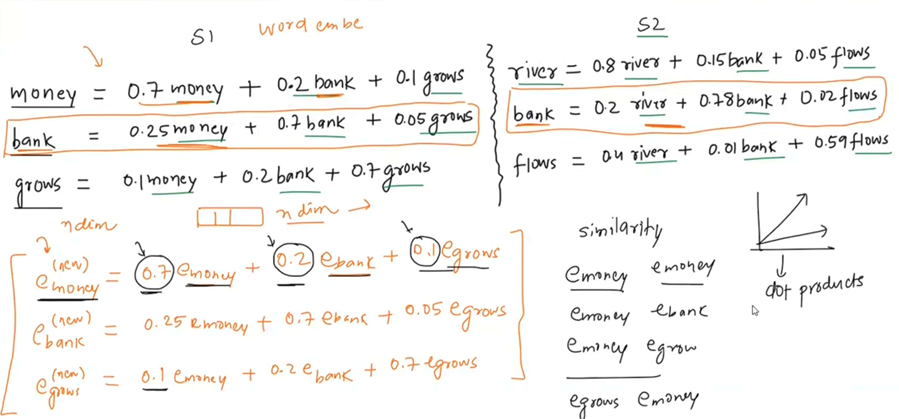
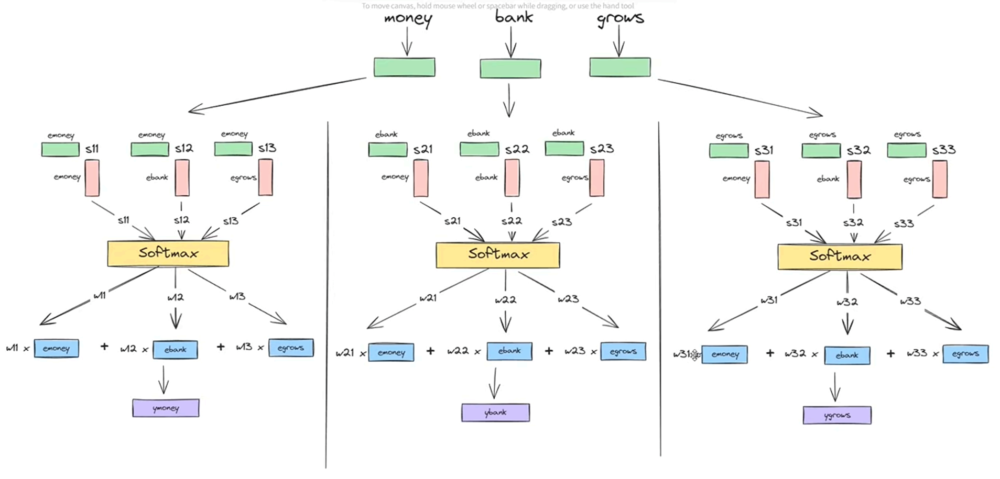
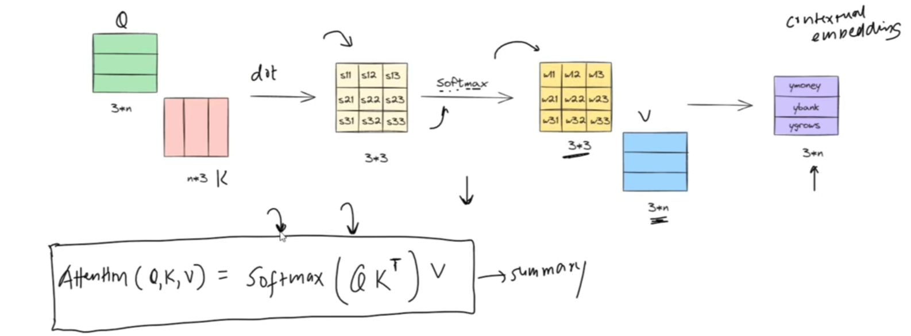
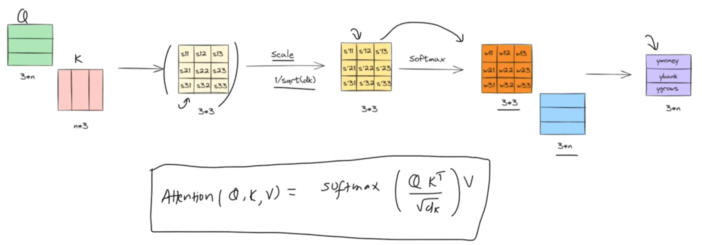

# Transformer & Attention Mechanisms: A Structural Overview

## Introduction to Sequence Modeling

### Background & Evolution
- Sequence-to-Sequence task.
- Sequence to Sequence Learning with Neural Networks (2014).
- Neural Machine Translation by jointly learning to align and translate (2014).
- Attention Is All You Need (2017).

- RNN -> LSTM -> GRU -> Encoder Decoder -> Attention -> Transfromers

### Impact of Transformers
- Revolution in NLP.
- Democratization of AI.
- Multimodal capability.
- Acceleration of GenAI.
- Unification of deep learning.

### Advantages & Disadvantages of Transformers
#### Advantages
- Scalability.
- Transfer learning.
- Multimodal I/O.
- Flexible architecture (encoder BERT, decoder GPT).
- Ecosystem.
- Integration with other AI techniques.

#### Disadvantages
- High computational cost.
- Requires a large amount of data.
- Overfitting risk.
- Energy consumption.
- Interpretability.
- Bias.

---

## The Pre-Transformer Era

### Previous Embedding Approaches
- One-hot encoding.
- Bag of Words.
- TF-IDF.
- Word embeddings.

### Limitations of Previous Approaches
- Word embeddings do not create task-related embeddings.
- In the phrases `money bank grows` and `river bank flows`, the word `bank` has different meanings.
- However, traditional word embeddings give the exact same embedding vector for both tokens.
- The embedding of `bank` (or any token) should vary according to the other tokens in the sentence.

---

## General Contextual Embedding

### Core Concept & Mechanics
- One way is to convert each embedding into a weighted sum of similarity scores with other embeddings in the sentence.

 

e(new)bank = [ebank &middot; eTmoney] emoney + [ebank &middot; eTbank] ebank + [ebank &middot; eTgrows] egrows

 

- We can call this dot product a similarity score and represent it with $S$, such as $S_{11}$, $S_{12}$, etc.
- We can also apply softmax to the new esimilarity score to bring its values between 0 and 1. The general formula for softmax is:

$$\frac{e^x}{e^x + e^y + e^z}$$

- In our case, $x$, $y$, and $z$ are the three dot products. After applying softmax, we represent them with $w$ (such as $w_{11}$, $w_{12}$, etc.).

$$w_{11} = \frac{e^{S_{11}}}{e^{S_{11}} + e^{S_{12}} + e^{S_{13}}}$$

- Then, we multiply these weights with their respective token embeddings and sum them up:

$$\boxed{e^{(new)}_{money} = w_{11} \cdot e_{money} + w_{12} \cdot e_{bank} + w_{13} \cdot e_{grows}}$$

- Basically, we store the similarity score of each token with its neighboring tokens.
- As a result, a token's embedding is affected by its neighboring tokens.

- The entire thing can be executed in parallel, as shown here:

### Problems with the General Contextual Approach
- Loses sequential order information.
- Doesn't learn from history, causing issues like misunderstanding idiomatic phrases (e.g., `piece of cake` meaning `easy`).
- `break a leg` means `good luck`.
- It is not task-specific; it is a general contextual embedding.

---

## Self-Attention Mechanism

### Evolution to Self-Attention
- Task-specific contextual embeddings.
- Dynamic contextual embeddings.

- The previous general contextual approach did not learn from data. To make our embeddings learn from data, we need to introduce learnable parameters (weights) into our embedding generation process.
- Recall the pipeline: **Dot Product (Similarity Score) $\rightarrow$ Softmax (Weights) $\rightarrow$ Dot Product (Weighted Sum)**.
- Since we cannot introduce weights into the softmax function, we apply them to the dot product stages.

### The Intuition: Query, Key, and Value
- Just like how we don't upload our entire autobiography everywhere to find a specific piece of information, we shouldn't use a single vector for everything.
- Instead, we extract 3 distinct vectors from each embedding vector:
  - **Query vector ($Q$)**: What am I looking for?
  - **Key vector ($K$)**: What kind of information do I hold? (Like an index or label)
  - **Value vector ($V$)**: What is my actual content?

- Think of it like querying a dictionary or a database: **`dict[key] = value`**. 
- You look up an entry by matching your **Query** against the **Keys**, and it returns the corresponding **Value**.

- **First Dot Product ($Q \cdot K$):** Calculates the similarity score. It is like each token querying every other embedding: *"How relevant are your keys to my query?"*
- **Second Dot Product (Weights $\cdot V$):** After applying softmax to get the attention weights, we multiply those weights by the **Value** vectors to compute the final contextual embedding.

- The updated architecture will use query, key, and value vectors like this:

### Deriving Q, K, and V via Linear Transformations
- The remaining question is: How do we derive the query, key, and value vectors from the embedding vectors?

- In linear algebra, we can transform vectors into other vectors using linear transformations:
  - We can scale a vector to change its magnitude.
  - We can apply a linear transformation to change both its magnitude and direction.

- We can multiply an embedding vector by a weight matrix to obtain the resulting **query** vector. Similarly, we can obtain the **key** and **value** vectors.
- The weight matrices used for these transformations are denoted by `Wq`, `Wk`, and `Wv`, respectively.

### Learning Weights Through Training
- The next question is: What values should `Wq`, `Wk`, and `Wv` have?
- As discussed earlier, we need learnable parameters that allow the model to learn patterns from data. We initialize these weight matrices with random values. During training, backpropagation and gradient-based optimization update the weights so that the model can learn useful query, key, and value representations.

- The final attention forumla that we reached can be given by:
$$\boxed{Attention = Softmax(QK^T).V}$$

---

### Why Scaling is Necessary in Self-Attention

* **Variance Growth:** The dot product operation naturally increases the variance of its output as the dimensionality of the vectors increases.
* **Softmax Saturation and Vanishing Gradients:** The Softmax function tends to saturate at extreme variance values, outputting probabilities very close to $0$ or $1$. This causes severe issues during backpropagation: gradients vanish, leading the model to focus exclusively on large weights while smaller weights are neglected.
* **Variance Scaling Property:** According to the properties of variance, if a random variable $X$ has a variance of $\text{var}(X)$ and is scaled by a constant $c$ (such that $Y = cX$), the new variance becomes:

$$\text{var}(cX) = c^2 \text{var}(X)$$

* **Dimensionality Effect:** For two vectors of dimension $d_k$, their dot product sums $d_k$ independent components, effectively scaling the variance by $d_k$. To counteract this and stabilize the variance back to $1$, we divide by $\sqrt{d_k}$ (since scaling by $\frac{1}{\sqrt{d_k}}$ scales the variance down by $\frac{1}{d_k}$).

### Scaled Dot-Product Attention Equation

$$\boxed{\text{Attention}(Q, K, V) = \text{Softmax}\left(\frac{QK^T}{\sqrt{d_k}}\right)V}$$

---

### Summary of the Attention Pipeline

* **Step 1: Generating Q, K, and V Matrices:** From the input embeddings, we project them into Query ($Q$), Key ($K$), and Value ($V$) matrices by multiplying them by their respective learned weight matrices ($W_Q$, $W_K$, and $W_V$).

* **Step 2: Computing Contextualized Embeddings:** We apply the scaled attention equation ($\frac{QK^T}{\sqrt{d_k}}$), pass the result through the Softmax function to obtain attention weights, and multiply by $V$ to produce the new, updated contextualized embeddings.

## Problems with Self Attention
- Can only capture one perspective since it only creates a single similarity matrix.
- For example a sentence `A man saw an astronaut with a telescope` can have two meaning:
  - Man had telescope using which he saw astronaut.
  - Man saw a astronaut who had a telescope.
- Self attention will move towards one of these meanings depending on similarity score matrix it created.

# MultiHead Attention
- To capture multiple perspective we use multihead self attention.
- We concatenate different embeddings generated from each head and then pass for linear projection, at end the output embedding size should be same as input embedding size.

# Problems
- Parallel processing also means that self attention loses order of words.
- we need a way to put positional values.