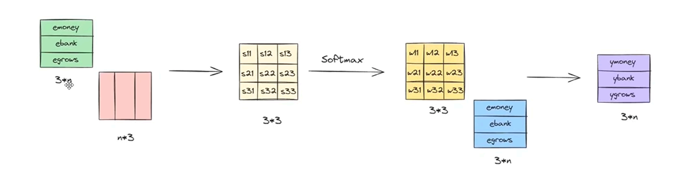

[Transformer](./index.md) > General Contextual Embedding

# General Contextual Embedding

## Core Concept & Mechanics
- One way is to convert each embedding into a weighted sum of similarity scores with other embeddings in the sentence.

 

e(new)bank = [ebank &middot; eTmoney] emoney + [ebank &middot; eTbank] ebank + [ebank &middot; eTgrows] egrows

 

- We can call this dot product a similarity score and represent it with $S$, such as $S_{11}$, $S_{12}$, etc.
- We can also apply softmax to the new similarity score to bring its values between 0 and 1. The general formula for softmax is:

$$\frac{e^x}{e^x + e^y + e^z}$$

- In our case, $x$, $y$, and $z$ are the three dot products. After applying softmax, we represent them with $w$ (such as $w_{11}$, $w_{12}$, etc.).

$$w_{11} = \frac{e^{S_{11}}}{e^{S_{11}} + e^{S_{12}} + e^{S_{13}}}$$

- Then, we multiply these weights with their respective token embeddings and sum them up:

$$\boxed{e^{(new)}_{money} = w_{11} \cdot e_{money} + w_{12} \cdot e_{bank} + w_{13} \cdot e_{grows}}$$

- Basically, we store the similarity score of each token with its neighboring tokens.
- As a result, a token's embedding is affected by its neighboring tokens.

- The entire thing can be executed in parallel, as shown here:

## Problems with the General Contextual Approach
- Loses sequential order information.
- Doesn't learn from history, causing issues like misunderstanding idiomatic phrases (e.g., `piece of cake` meaning `easy`).
- `break a leg` means `good luck`.
- It is not task-specific; it is a general contextual embedding.