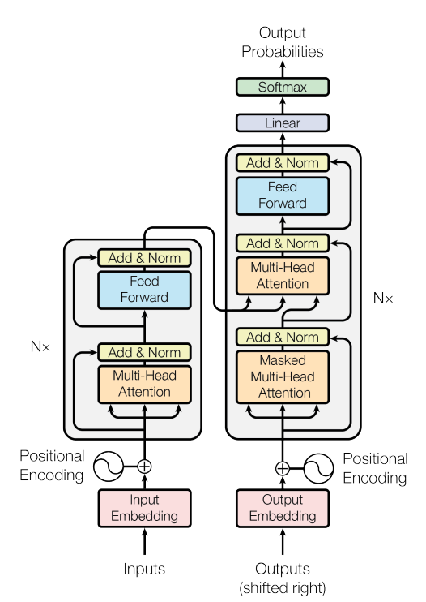

[Transformer](./index.md) > Introduction

# Introduction to Sequence Modeling

## Background & Evolution
- Sequence-to-Sequence task.
- Sequence to Sequence Learning with Neural Networks (2014).
- Neural Machine Translation by jointly learning to align and translate (2014).
- Attention Is All You Need (2017).

- RNN -> LSTM -> GRU -> Encoder Decoder -> Attention -> Transformers

## Impact of Transformers
- Revolution in NLP.
- Democratization of AI.
- Multimodal capability.
- Acceleration of GenAI.
- Unification of deep learning.

## Advantages & Disadvantages of Transformers
### Advantages
- Scalability.
- Transfer learning.
- Multimodal I/O.
- Flexible architecture (encoder BERT, decoder GPT).
- Ecosystem.
- Integration with other AI techniques.

### Disadvantages
- High computational cost.
- Requires a large amount of data.
- Overfitting risk.
- Energy consumption.
- Interpretability.
- Bias.