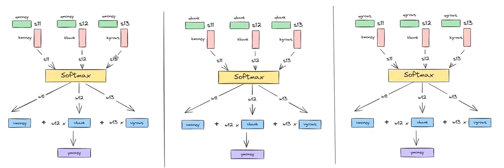

[Transformer](./index.md) > Self-Attention Mechanism

# Self-Attention Mechanism

## Evolution to Self-Attention
In the previous approach, we computed context by taking a weighted sum of neighboring token embeddings based on similarity scores. However, that general contextual method has a major limitation: it does not learn from data.

To make our embeddings truly data-driven, we need to introduce learnable parameters (weights) into our embedding generation process.

Recall the pipeline:  
**Dot Product (Similarity Score) $\rightarrow$ Softmax (Weights) $\rightarrow$ Dot Product (Weighted Sum)**.

Since we cannot introduce weights into the softmax function, we can only apply them to the dot product stages.

## The Intuition: Query, Key, and Value
- Just like how we don't upload our entire autobiography everywhere to find a specific piece of information, we shouldn't use a single vector for everything.
- Instead, we extract 3 distinct vectors from each embedding vector:
- **Query vector ($Q$)**: What am I looking for?
- **Key vector ($K$)**: What kind of information do I hold? (Like an index or label)
- **Value vector ($V$)**: What is my actual content?

- Think of it like querying a dictionary or a database: **`dict[key] = value`**. 
- You look up an entry by matching your **Query** against the **Keys**, and it returns the corresponding **Value**.

- **First Dot Product ($Q \cdot K$):** Calculates the similarity score. It is like each token querying every other embedding: *"How relevant are your keys to my query?"*
- **Second Dot Product (Weights $\cdot V$):** After applying softmax to get the attention weights, we multiply those weights by the **Value** vectors to compute the final contextual embedding.

- The updated architecture will use query, key, and value vectors like this:

## Deriving Q, K, and V via Linear Transformations
- The remaining question is: How do we derive the query, key, and value vectors from the embedding vectors?

- In linear algebra, we can transform vectors into other vectors using linear transformations:
- We can scale a vector to change its magnitude.
- We can apply a linear transformation to change both its magnitude and direction.

- We can multiply an embedding vector by a weight matrix to obtain the resulting **query** vector. Similarly, we can obtain the **key** and **value** vectors.
- The weight matrices used for these transformations are denoted by `Wq`, `Wk`, and `Wv`, respectively.

## Learning Weights Through Training
- The next question is: What values should `Wq`, `Wk`, and `Wv` have?
- As discussed earlier, we need learnable parameters that allow the model to learn patterns from data. We initialize these weight matrices with random values. During training, backpropagation and gradient-based optimization update the weights so that the model can learn useful query, key, and value representations.

- The final attention formula that we reached can be given by:
$$\boxed{Attention = Softmax(QK^T).V}$$

---

## Why Scaling is Necessary in Self-Attention

- **Variance Growth:** The dot product operation naturally increases the variance of its output as the dimensionality of the vectors increases.
- **Softmax Saturation and Vanishing Gradients:** The Softmax function tends to saturate at extreme variance values, outputting probabilities very close to $0$ or $1$. This causes severe issues during backpropagation: gradients vanish, leading the model to focus exclusively on large weights while smaller weights are neglected.
- **Variance Scaling Property:** According to the properties of variance, if a random variable $X$ has a variance of $\text{var}(X)$ and is scaled by a constant $c$ (such that $Y = cX$), the new variance becomes:

$$\text{var}(cX) = c^2 \text{var}(X)$$

- **Dimensionality Effect:** For two vectors of dimension $d_k$, their dot product sums $d_k$ independent components, effectively scaling the variance by $d_k$. To counteract this and stabilize the variance back to $1$, we divide by $\sqrt{d_k}$ (since scaling by $\frac{1}{\sqrt{d_k}}$ scales the variance down by $\frac{1}{d_k}$).

### Scaled Dot-Product Attention Equation

$$\boxed{\text{Attention}(Q, K, V) = \text{Softmax}\left(\frac{QK^T}{\sqrt{d_k}}\right)V}$$

---

## Summary of the Attention Pipeline

- **Step 1: Generating Q, K, and V Matrices:** From the input embeddings, we project them into Query ($Q$), Key ($K$), and Value ($V$) matrices by multiplying them by their respective learned weight matrices ($W_Q$, $W_K$, and $W_V$).

- **Step 2: Computing Contextualized Embeddings:** We apply the scaled attention equation ($\frac{QK^T}{\sqrt{d_k}}$), pass the result through the Softmax function to obtain attention weights, and multiply by $V$ to produce the new, updated contextualized embeddings.

## Limitations of Self Attention
- Can only capture one perspective since it only creates a single similarity matrix.
- For example a sentence `A man saw an astronaut with a telescope` can have two meanings:
- Man had a telescope using which he saw an astronaut.
- Man saw an astronaut who had a telescope.
- Self attention will move towards one of these meanings depending on the similarity score matrix it created.